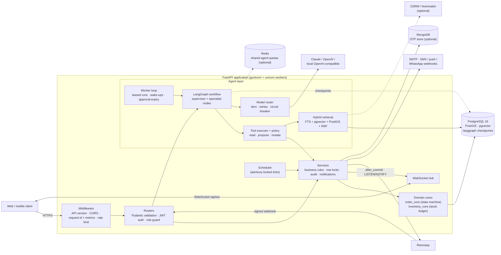
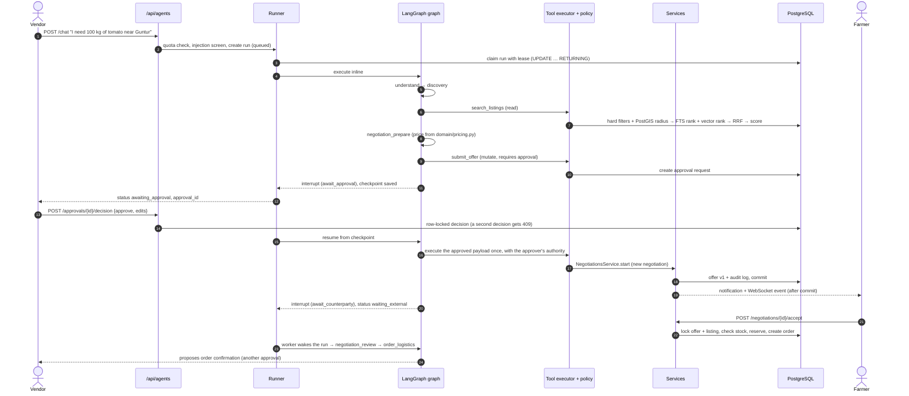
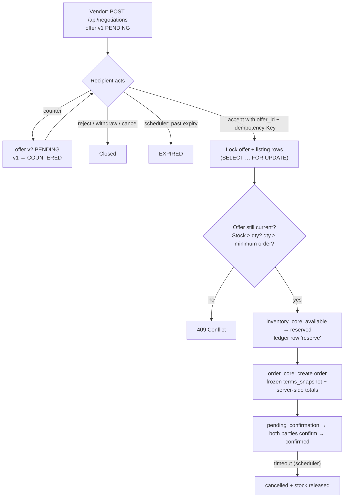
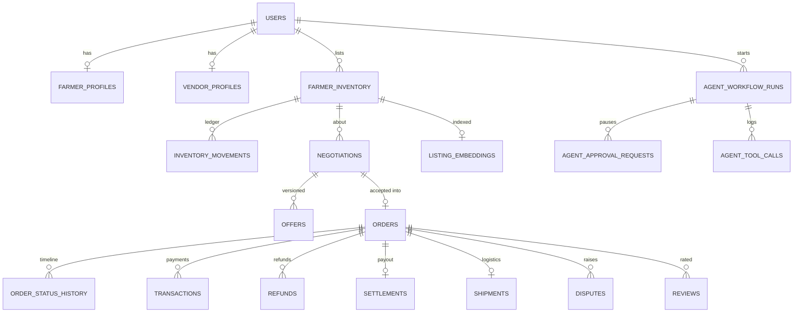

# Smart-Agri-Tech

**A negotiation-first B2B marketplace for agricultural produce, with a human-approved AI agent layer.**
Farmers list produce, vendors negotiate price and quantity, and every agreed deal becomes a
tracked order that runs through payment, delivery, settlement, reviews and disputes. A stateful
LangGraph assistant finds suppliers or buyers, prepares offers and listings, and investigates
disputes. It never takes a consequential action without explicit human approval.

| | |
|---|---|
| **Problem** | Smallholder farmers sell through intermediaries and can't see what prices others are getting. Vendors struggle to find, compare and trust suppliers. Deals are negotiated over the phone and paid in cash, with no record of what was agreed |
| **Solution** | One backend for discovery, versioned negotiation, order lifecycle, payments, logistics, dispute resolution and trust signals, plus an AI agent that does the search and preparation work while people keep the decisions |
| **Users** | Farmers, vendors (wholesale buyers) and platform admins |
| **Scale of the codebase** | 276 HTTP routes plus a WebSocket channel · 70 PostgreSQL tables · 7 Alembic migrations · 142 automated tests · 32 routers / 40 services |
| **Stack** | Python 3.13 · FastAPI (async) · SQLAlchemy 2.0 · PostgreSQL 16 + PostGIS + pgvector · LangGraph · Razorpay · Docker · GitHub Actions |
| **Version** | 2.0.0, containerised and CI-gated (lint, full test suite on PostgreSQL, migration drift check, image builds) |

### What makes it technically interesting

- **Money and stock are always correct, even under concurrency.** Stock changes take row locks
  (`SELECT … FOR UPDATE`). Critical writes are protected by idempotency keys. Payments are
  confirmed server-side by signature, signed webhook or reconciliation. An append-only stock
  ledger accounts for every quantity.
- **The AI agent can't do anything without approval.** Every tool has a declared kind (read,
  propose or mutate), the roles allowed to use it, and an approval rule. Mutations pause the
  LangGraph run as an approval request and execute once, with the payload the person approved.
  Prices come from deterministic rules, never from the model.
- **Agent runs are durable.** Checkpoints are stored in PostgreSQL and workers claim runs with
  leases. A run can pause for days while the counterparty responds, survive a restart, and
  resume where it left off.
- **Supplier search combines three signals.** Results merge PostgreSQL full-text search and
  pgvector similarity through reciprocal rank fusion, filtered by a PostGIS radius, with an
  optional cross-encoder reranker. A final explainable score weighs relevance, price, distance,
  quantity, trust and freshness.
- **Model providers are interchangeable.** Claude, OpenAI, any OpenAI-compatible local server,
  or no model at all. Routing picks a tier per task, with retries, a circuit breaker and
  fallback across providers. With no model available, every task has a deterministic
  implementation, so the assistant keeps working.

---

## Contents

1. [Key features](#key-features)
2. [Architecture](#architecture)
3. [End-to-end flows](#end-to-end-flows)
4. [Technology stack](#technology-stack)
5. [Project structure](#project-structure)
6. [Technical deep dive](#technical-deep-dive)
7. [Data model and API](#data-model-and-api)
8. [Setup and local development](#setup-and-local-development)
9. [Configuration reference](#configuration-reference)
10. [Testing and quality](#testing-and-quality)
11. [Security and reliability](#security-and-reliability)
12. [Deployment](#deployment)
13. [Roadmap](#roadmap)
14. [Engineering highlights](#engineering-highlights)

---

## Key features

| Area | Capabilities |
|---|---|
| **Accounts and trust** | OTP verification by SMS or email; per-device sessions with refresh-token rotation and reuse detection; TOTP MFA for admins; identity, farm and business verification; public trust profiles (completed orders, on-time, cancellation and dispute rates, ratings) |
| **Listings and inventory** | Grades, harvest and expiry dates, photos, quantity-discount tiers, certifications, a private minimum price, drafts and pause. Stock is tracked as available, reserved and sold, with an append-only movement ledger |
| **Discovery** | Filtered and sorted market search; saved listings with price-change alerts; favourite farmers; saved-search crop alerts |
| **Negotiation** | Versioned offers and counteroffers, expiry, withdraw, reject and cancel; comparison across farmers; atomic acceptance that reserves stock and creates the order |
| **Orders** | Immutable snapshot of the agreed terms; server-computed totals (fee, tax, packaging, transport, discount); both-party confirmation; a 12-state lifecycle with payment-term gating; cancellation policy; invoices; reorder |
| **Payments** | Razorpay checkout, signature verification, signed and deduplicated webhooks, reconciliation, offline cash, UPI and bank records, separate refund records, farmer settlements |
| **Logistics** | Pickup and delivery plans, dispatch with photo proof, a one-time delivery code, accepted quantity and quality, failed delivery and rescheduling |
| **Communication** | Chat tied to a listing, negotiation, order or dispute; attachments; read receipts; block and report; live WebSocket delivery; multi-channel notifications (in-app, email, SMS, push, WhatsApp) with retries, quiet hours and deduplication |
| **Disputes and reviews** | Evidence, case thread, escalation, resolutions that create refund records; multi-dimension reviews with moderation |
| **Procurement and planning** | Vendor buy requests, farmer quotations, comparison, split fulfilment, recurring supply agreements, harvest calendar with pre-harvest listings |
| **Insights** | Asking prices and negotiated prices reported separately (median, range, sample size, reliability flag); weekly trends; price checks; demand forecast; farmer and vendor dashboards |
| **AI assistant** (`/api/agents`) | Hybrid supplier and buyer search, offer preparation with rule-computed prices, bounded multi-round negotiation, listing drafts from photos with quality claims checked against the images, order and pickup tracking, dispute investigation reports for admins, voice-note transcription |
| **Admin** | User moderation, verification and appeal review, audited order adjustments, refunds, settlements, payment reconciliation, versioned platform settings, catalog, announcements, support tickets, audit log search, metrics, manual job runs, agent oversight |
| **Localisation** | English and Telugu notifications, status labels and catalog names |
| **ML** | Crop recommendation from soil and weather inputs (scikit-learn RandomForest, `POST /api/predict/`) |

---

## Architecture

The API is a layered monolith: Router → Service → Database, wired with FastAPI dependency
injection. The agent layer sits beside the services. It reaches marketplace data only through
those same services, so every authorisation and business rule applies to it too. A policy
layer then decides which agent actions need approval.



| Component | Responsibility | Key files |
|---|---|---|
| Application and middleware | Lifespan (scheduler, pub/sub, agent runtime), `/api/v1` aliasing, CORS, request ids, security headers, metrics, rate limiting, uniform error bodies | [main.py](main.py), [src/core/observability.py](src/core/observability.py), [src/core/rate_limit.py](src/core/rate_limit.py) |
| Routers | One file per domain; validation, authentication and role checks | [src/routers/](src/routers/) |
| Services | Business logic and ownership checks; commit boundaries | [src/services/](src/services/) |
| Order and inventory cores | Single source of truth for order transitions and stock movements; they never commit, the calling service does | [src/services/order_core.py](src/services/order_core.py), [src/services/inventory_core.py](src/services/inventory_core.py) |
| Cross-cutting core | Idempotency, audit, encryption, TOTP, OTP, money, notification channels, real-time fan-out, scheduler, storage, i18n, versioned platform settings | [src/core/](src/core/) |
| Agent layer | Graph, nodes, tools, policy, runner and worker, model routing, retrieval, deterministic domain rules | [src/agents/](src/agents/) |
| Persistence | SQLAlchemy models, async and sync engines, Alembic migrations, idempotent seeder | [src/data_models/](src/data_models/), [src/db_connections/](src/db_connections/), [alembic/](alembic/), [src/seeds/](src/seeds/) |

**Three database drivers, each for one job.** asyncpg serves API traffic, psycopg2 serves
Alembic and the seeder, and psycopg 3 (pooled) serves the LangGraph checkpointer, which is
written against psycopg.

---

## End-to-end flows

### 1. AI-assisted procurement: from a chat message to an order

This is the main flow. A vendor asks the assistant for produce, approves an offer it prepared,
and the run sleeps until the farmer responds.



What the flow guarantees:

- **Bounded graph.** [src/agents/graph.py](src/agents/graph.py) defines an explicit transition
  allow-list. A node can only hand off to its listed successors. A blocked transition ends the
  run in `respond`, and `AGENT_MAX_STEPS` caps the total number of steps.
- **Validated tools.** The executor in [src/agents/tools/base.py](src/agents/tools/base.py)
  rejects tools that aren't in the catalogue and tools the caller's role doesn't allow, and
  validates arguments with Pydantic. Every call is logged to `agent_tool_calls`, and mutations
  are audited as `agent.<tool>` with the approval id.
- **Failure handling.** A failed step is retried up to `AGENT_MAX_ATTEMPTS` times in a row.
  Progress resets the counter, so a long run with many pauses is never failed for being long.
  A crashed worker leaves an expired lease, which the next worker picks up.
- **Time limits.** Approvals expire after `AGENT_APPROVAL_TTL_HOURS`. Negotiation is limited to
  `AGENT_MAX_NEGOTIATION_ROUNDS`.

### 2. Negotiation to order (marketplace core)



After confirmation, the order moves through `preparing → ready_for_pickup / in_transit →
delivered → completed`. Payment terms are checked before `preparing`, `in_transit` and
`completed`. Completion creates the farmer's settlement and the invoice. A dispute freezes the
order, and its resolution produces refund records; payment rows are never edited.

---

## Technology stack

| Role | Technologies |
|---|---|
| Language and framework | Python 3.13 (3.10+ supported), FastAPI 0.115 on Starlette, Pydantic 2, pydantic-settings |
| Serving | Gunicorn 23 with Uvicorn workers; native WebSockets |
| Database and persistence | PostgreSQL 16, SQLAlchemy 2.0 (async), asyncpg, psycopg2, psycopg 3 pool, Alembic |
| Geo and vector | PostGIS 3.4 (geography, GiST radius queries), pgvector (dimension-free embeddings) |
| AI and agents | LangGraph 1.2 with `langgraph-checkpoint-postgres`; Anthropic Messages API and OpenAI-compatible APIs over plain HTTP (httpx, no provider SDKs); Sentence Transformers (`intfloat/multilingual-e5-small` embeddings, optional mMARCO cross-encoder reranker); Pillow for image preparation |
| ML | scikit-learn RandomForest, pandas, numpy (crop recommendation) |
| Optional stores | MongoDB 7 via Motor (OTP store; PostgreSQL also supported), Redis (global agent quotas) |
| Security | python-jose (JWT), passlib + bcrypt, `cryptography` (Fernet), RFC 6238 TOTP |
| Integrations | Razorpay (payments, refunds, webhooks), SMTP, webhook-based SMS / push / WhatsApp gateways, OSRM, Nominatim |
| Background work | In-process asyncio scheduler with PostgreSQL advisory locks; agent worker loop with leased runs; both can run as dedicated processes |
| Infrastructure | Multi-stage Docker image (non-root, health check), Docker Compose, custom PostgreSQL image with PostGIS + pgvector |
| CI and quality | GitHub Actions, pytest 9, ruff |
| Observability | JSON logs with request ids, Prometheus-format `/metrics`, readiness checks, admin metrics and agent usage dashboards |

All runtime versions are pinned in [requirements.txt](requirements.txt).

---

## Project structure

```
smart-agri-tech/
├── main.py                     # app factory, middleware stack, router registration, lifespan
├── src/
│   ├── routers/                # HTTP endpoints, one module per domain (32 routers)
│   ├── services/               # business logic (order_core / inventory_core are the shared cores)
│   ├── core/                   # idempotency, audit, crypto, TOTP, OTP, money, realtime, scheduler,
│   │                           # rate limiting, storage, channels, i18n, platform settings
│   ├── agents/
│   │   ├── graph.py            # LangGraph graph + transition allow-list
│   │   ├── nodes/              # supervisor, discovery, negotiation, listing, logistics, disputes, respond
│   │   ├── tools/              # tool catalogue and the policy-enforcing executor (base.py)
│   │   ├── policy.py           # tool kinds, roles, approval rules, prompt-injection screening
│   │   ├── runner.py, worker.py, runtime.py   # durable runs: leases, resume, wake-ups, expiry
│   │   ├── checkpointer.py     # PostgreSQL (or memory) LangGraph checkpointer
│   │   ├── llm/                # provider adapters, presets, registry, router, circuit breaker
│   │   ├── retrieval/          # embeddings, hybrid search, RRF ranking, reranker, geo, indexer
│   │   ├── domain/             # deterministic rules: understanding, pricing, quality, disputes
│   │   ├── integrations/       # maps (offline estimate / OSRM / Nominatim)
│   │   └── vision.py, redaction.py, limits.py
│   ├── data_models/            # SQLAlchemy models (registry.py imports all of them)
│   ├── schemas/                # Pydantic request schemas
│   ├── security_utils/         # hashing, JWT helpers, role guard
│   ├── db_connections/         # async/sync engines, MongoDB, migration helpers
│   ├── seeds/                  # idempotent reference-data seeder + JSON data
│   ├── ml_models/              # crop recommendation model and training script
│   └── helpers/                # logging, SMTP, settings, serializers
├── alembic/versions/           # migrations 000–006
├── docker/postgres/            # PostgreSQL 16 + PostGIS + pgvector image
├── tests/
│   ├── unit/                   # core, realtime, schema indexes, agent policy/LLM/domain
│   ├── seeds/                  # seeder behaviour on PostgreSQL
│   └── api/                    # end-to-end marketplace and agent flows over HTTP
├── config/llm_models.example.json   # optional hand-written model registry
├── docs/seeding.md
├── Dockerfile, entrypoint.sh, gunicorn.conf.py, compose.yml
└── .github/workflows/ci.yml
```

---

## Technical deep dive

### Concurrency and consistency

| Risk | Mechanism |
|---|---|
| Two vendors buy the last stock at once | `inventory_core.lock_listing` takes `SELECT … FOR UPDATE` before any stock change |
| Two parties change one order at once | `order_core.lock_order` row-locks the order for every transition |
| Accepting an offer that changed in the meantime | Accept must name the current `offer_id`; offer and listing rows are locked |
| A client retries and creates duplicates | `Idempotency-Key` scoped to `(user, endpoint, key)` with a SHA-256 body fingerprint; unique constraints as the final guard |
| Duplicate webhook delivery | Unique `webhook_events.event_id`; repeats return `{"status": "duplicate"}` |
| Several replicas run the same job | `pg_try_advisory_lock` around each scheduler tick |
| Sweeps block user requests | `FOR UPDATE SKIP LOCKED` with batch limits |
| Two agent workers continue the same run | Lease claim via `UPDATE … RETURNING`; an expired lease is recovered |
| An approval is decided twice | Row-locked state change; the second decision gets 409 |
| Events are sent for rolled-back data | Real-time events are queued on the session and published only from SQLAlchemy `after_commit` |

### Order state machine

`order_core.TRANSITIONS` maps every `(from, to)` pair to the parties allowed to make it
(farmer, vendor, admin or system). Each transition writes a status-history row and an audit row,
notifies the other party, and applies the matching stock operation: release on cancellation,
hold on confirmation, consume on delivery.

```
pending_confirmation ─▶ confirmed ─▶ preparing ─▶ ready_for_pickup ─▶ in_transit ─▶ delivered ─▶ completed
        └──────────────── cancelled ◀───────────────────┘          delivery_failed   disputed ─▶ refund_pending ─▶ refunded
```

### Money handling

- Amounts are `NUMERIC` in PostgreSQL and `Decimal` in Python, rounded `ROUND_HALF_UP`, and
  converted to integer paise for Razorpay. Floats are never used for money.
- Clients never send totals. `compute_breakdown` derives subtotal, platform fee, tax on the fee,
  packaging, transport and discount, then freezes the result into `orders.terms_snapshot`.
- Paid, refunded and outstanding amounts are recomputed from the records each time. No running
  total is stored, so nothing can drift.
- Settlement: `net = gross − fee (if the farmer pays) + adjustments − refunds − cash collected directly`.

### Payments

1. `POST /api/order/payment` computes the amount server-side for the purpose (`auto`, `advance`,
   `full` or `balance`). An unpaid gateway order for the same amount created in the last 30
   minutes is reused, which prevents duplicate checkouts.
2. A payment is confirmed by whichever of these arrives first, and marking it paid is idempotent:
   - the client-side signature check;
   - the HMAC-verified webhook (the raw body is compared in constant time, events are
     deduplicated by id, and the captured amount must match);
   - admin reconciliation against Razorpay.
3. Refunds are separate rows, finalised by the `refund.processed` / `refund.failed` webhooks.

### Agent orchestration

- **Graph.** A single flat `StateGraph` with a supervisor (`understand` / `clarify`) and
  specialists for discovery, vendor demand, market insight, negotiation, listing, logistics,
  disputes and admin oversight. Every path ends in `respond`. Keeping it flat puts every
  interrupt in one checkpoint namespace, which keeps resume and inspection simple.
- **Interrupts.** Three kinds: user input, approval, and external events (the counterparty acts).
  The worker loop polls every 3 seconds. It picks up queued runs, runs with expired leases, and
  runs whose wake condition was met.
- **Tool policy** ([src/agents/policy.py](src/agents/policy.py)):

  | Kind | Examples | Rule |
  |---|---|---|
  | `read` | search listings, load an order, price statistics | Runs immediately with the user's own access rights |
  | `propose` | prepare an offer, draft a listing, plan a pickup | Runs immediately; the result is shown to the user as a proposal |
  | `mutate` | `submit_offer`, `respond_to_offer`, `create_order`, `confirm_order`, `schedule_pickup`, `create_listing`, `resolve_dispute` | Pauses for approval; executes once with the approved payload |

  No tool exists for marking delivery, moving money, or suspending or verifying users.
- **Deterministic core.** Offer prices ([src/agents/domain/pricing.py](src/agents/domain/pricing.py))
  come from recorded deals, the listing, and the farmer's private floor price, which is never
  revealed. Quality claims in listing drafts are checked against the photos. Dispute reports
  separate verified facts with evidence references from conflicts, assumptions and unknowns, and
  never make the decision.
- **Prompt-injection defence.** Text from listings, chats and uploads is treated as data.
  Instruction-like patterns are refused and recorded in the trace. Traces are redacted before
  they are stored or returned.
- **Model routing** ([src/agents/llm/](src/agents/llm/)). Models are registered by tier (`fast`,
  `standard` or `strong`) and capability (text, structured output, tool calling, vision, audio
  transcription). Each task requests a tier, and the router tries candidates in preference order
  across providers. Calls retry with exponential backoff, and a per-model circuit breaker stops
  calls to a failing model. Structured output is validated against a JSON schema; invalid output
  falls back to the rules. Every model call is logged with latency, tokens and cost.

### Hybrid retrieval

[src/agents/retrieval/search.py](src/agents/retrieval/search.py):

1. **Hard SQL filters.** Live listings only (active, in stock, not expired, not deleted),
   matched on commodity, quantity and minimum order, grade, availability, delivery option and
   organic or verified status, within a PostGIS radius. The viewer's own listings and blocked
   counterparties are excluded.
2. **Lexical ranking.** PostgreSQL full-text search over the indexed listing text, with a GIN
   index.
3. **Semantic ranking.** pgvector cosine similarity using multilingual E5 embeddings, with query
   and passage prefixes, so Telugu produce names match too.
4. **Reciprocal rank fusion** (`k = 60`). The two rankings are merged by rank, which avoids
   comparing `ts_rank` and cosine scores on their very different scales. The top N can then be
   reranked by a cross-encoder.
5. **Explainable business score.** Relevance 0.35, price 0.20, distance 0.15, quantity 0.15,
   trust 0.10, freshness 0.05 (configurable). Availability is checked again at the end. Only real
   listing rows are returned, with the actual price, quantity and distance, and the response
   says which stages ran.

An hourly job re-embeds listings that are new or changed. Candidates without an embedding are
embedded on demand, up to 50 per search.

### Real-time delivery across processes

```
service → queue_event(session) → commit → after_commit → pg_notify('smart_agri_realtime')
        → every worker's LISTEN connection → that user's local WebSockets
rollback → queued events dropped
```

Payloads too large for NOTIFY are delivered locally instead. A watchdog reconnects a dropped
listener, and if the listener is unavailable, delivery falls back to the local process instead
of failing.

### Background jobs

[src/core/scheduler.py](src/core/scheduler.py) runs in the API process or as a dedicated worker.

| Frequency | Jobs |
|---|---|
| Every 60 s tick | Offer expiry warnings and expiry; order confirmation timeouts (stock released); notification delivery with exponential backoff (up to 5 attempts) |
| Hourly | Listing expiry; auto-complete and payment reminders; recurring orders; closing past-deadline buy requests; listing re-embedding |
| Daily | Price-change alerts; anonymising accounts past their deletion grace period; agent data retention |

Each job runs in its own session, so a failing job is rolled back and logged without stopping
the others. Admins can trigger any job with `POST /api/admin/jobs/run`.

### Database design

- **Indexes.** Every queried or cascaded foreign key has a leading-column index, which
  [tests/unit/test_schema_indexes.py](tests/unit/test_schema_indexes.py) enforces. List
  endpoints have composite indexes that match both the filter and the sort. Job sweeps use
  partial indexes that cover only the rows each job scans, and the marketplace feed uses a
  partial descending index. Geography columns have GiST indexes.
- **Integrity.** One review per order and reviewer, unique offer versions per negotiation,
  case-insensitive unique emails and reference names, unique external payment ids, and a partial
  unique index for notification deduplication.
- **ORM discipline.** Every relationship is declared `lazy="raise"`, so an accidental N+1 query
  fails loudly instead of running silently. Sessions use `expire_on_commit=False`, and API
  connections set a `statement_timeout`.
- **Zero-downtime migrations.** Migration `005` builds its indexes `CONCURRENTLY` and rebuilds
  any left `INVALID` by an interrupted run. Migrations work on fresh databases and on databases
  created by the original SQL scripts. CI runs `alembic check` to fail on model and migration
  drift.

---

## Data model and API

### Core entities



The 70 tables fall into these groups: identity and access, profiles and trust, reference data,
listings and stock, negotiation, orders and fulfilment, money, communication, disputes and
support, procurement and planning, platform (settings, audit, idempotency, files), and agents.

### API overview

Interactive OpenAPI docs are served at `/docs` and `/redoc` (switch them off with
`API_DOCS_ENABLED=false`). Every route is also available under `/api/v1`. Authenticate with
`Authorization: Bearer <access_token>`.

| Area | Representative endpoints |
|---|---|
| Auth | `POST /api/users`, `/verify-otp`, `/login/`, `/login/mfa`, `/token/refresh`, `/auth/logout`, `/auth/mfa/setup` |
| Listings and market | `POST /api/listings`, `PUT /listings/{id}/stock`, `GET /api/market/` |
| Negotiation | `POST /api/negotiations`, `/negotiations/{id}/offers`, `/accept`, `/reject`, `GET /negotiations/compare` |
| Orders and delivery | `GET /api/orders/{id}`, `/confirm`, `/status`, `/cancel`, `/shipment`, `/dispatch`, `/delivery/confirm` |
| Payments | `POST /api/order/payment`, `/order/verify-payment`, `/payments/webhook/razorpay`, `/orders/{id}/payments/manual` |
| Real time | `WS /api/ws?token=<access_token>`: `message`, `messages_read`, `notification`, `negotiation` events |
| AI agents | `POST /api/agents/chat`, `GET /workflows/{id}` (+ `/events`), `POST /approvals/{id}/decision`, `POST /discovery/search`, `POST /listings/from-images`, `POST /disputes/{id}/investigate`, `GET /admin/models` |
| Admin | `/api/admin/users`, `/verifications`, `/settings/{key}`, `/refunds`, `/payments/reconcile`, `/audit-logs`, `/jobs/run` |
| System | `GET /health`, `/health/ready`, `/metrics` (token-protected) |

**Conventions**

- Errors keep FastAPI's `detail` and add
  `error: {code, status, message, details, request_id}`.
- `X-Request-ID` is accepted or generated, and echoed in responses and logs.
- `Idempotency-Key` is accepted on order creation, offer acceptance, payment, agent chat and
  listing-from-images. A replay returns the stored response; reusing a key with a different
  body returns 409.
- Lists paginate with `page` and `page_size`. Money and quantities are exact decimals.

**Example: an agent conversation**

```http
POST /api/agents/chat
{"message": "make an offer for 100 kg on listing 12"}
→ {"status": "awaiting_approval", "pending": {"approval_id": "...", ...}}

POST /api/agents/approvals/{approval_id}/decision
{"decision": "approve", "edits": {"unit_price": 24}}
→ {"status": "waiting_external", ...}
```

---

## Setup and local development

### Prerequisites

- Docker and Docker Compose, **or** Python 3.10+ (3.13 recommended) with PostgreSQL 16 that has
  the `postgis` and `vector` extensions.
- MongoDB is optional; set `OTP_STORE=postgres` to keep OTPs in PostgreSQL instead.

### Quick start with Docker

```bash
git clone <repository-url> && cd smart-agri-tech
cp .env.example .env        # set POSTGRES_*, ACCESS_TOKEN, REFRESH_TOKEN, ALGORITHM
docker compose up --build
```

Compose builds PostgreSQL with PostGIS and pgvector and starts it alongside MongoDB 7, with
health checks. It then runs a one-shot job that applies the migrations, creates the LangGraph
checkpoint tables and seeds reference data, and finally starts the API on `BACKEND_PORT`
(default 8000). `docker compose --profile tools up` adds pgAdmin.

### Local Python environment

```bash
python -m venv venv && source venv/bin/activate      # Windows: venv\Scripts\activate
pip install -r requirements-dev.txt                   # runtime + pytest + ruff
pip install -r requirements-ml.txt                    # optional: local embedding models (CPU torch)
cp .env.example .env

alembic upgrade head                                  # schema
python -m src.agents.checkpointer setup               # LangGraph checkpoint tables
python -m src.seeds                                   # reference data (idempotent; --dry-run available)
python -m src.agents.retrieval.indexer reindex        # optional: embed existing listings

uvicorn main:smart_agri_tech_app --port 8000 --reload
```

Without `requirements-ml.txt`, set `EMBEDDING_PROVIDER=hashing`. On Windows, the psycopg-based
checkpointer needs the selector event loop: run the API through Docker, or set
`AGENT_CHECKPOINTER=memory` for a quick local run.

**First admin.** Registration allows only the Farmer and Vendor roles. Promote a registered
account in SQL, then enable MFA with `POST /api/auth/mfa/setup` and `/enable`:

```sql
UPDATE users SET role_id = (SELECT id FROM roles WHERE lower(name) = 'admin') WHERE email = '<admin email>';
```

---

## Configuration reference

All settings are environment variables (`.env` is loaded automatically).
[.env.example](.env.example) lists every one with safe placeholders.

| Variable | Required | Purpose |
|---|---|---|
| `POSTGRES_USER`, `POSTGRES_PASSWORD`, `POSTGRES_HOST`, `POSTGRES_DB` | Yes | PostgreSQL connection |
| `ACCESS_TOKEN`, `REFRESH_TOKEN`, `ALGORITHM` | Yes | JWT signing secrets and algorithm (e.g. `HS256`) |
| `DATA_ENCRYPTION_KEY` | In production | Fernet key for bank, UPI and MFA secrets (keep it stable) |
| `OTP_STORE`, `MONGO_*` | – | `mongo` (default, needs `MONGO_*`) or `postgres` |
| `ADMIN_MFA_REQUIRED` | – | Make MFA mandatory for admin endpoints |
| `CORS_ALLOW_ORIGINS`, `API_DOCS_ENABLED`, `TRUST_PROXY_HEADERS` | – | Edge behaviour |
| `DB_POOL_SIZE`, `DB_MAX_OVERFLOW`, `DB_STATEMENT_TIMEOUT_MS` | – | Pool sizing and query timeout |
| `RAZORPAY_KEY_ID`, `RAZORPAY_KEY_SECRET`, `RAZORPAY_WEBHOOK_SECRET` | For online payments | Checkout and webhook verification |
| `EMAIL_PROVIDER`, `SMS_PROVIDER`, `PUSH_PROVIDER`, `WHATSAPP_PROVIDER` (+ `*_WEBHOOK_URL` / `_TOKEN`) | – | Notification channels (`smtp`, `webhook` or `log`) |
| `SCHEDULER_ENABLED`, `REALTIME_PUBSUB`, `WEB_CONCURRENCY` | – | Background jobs, cross-process fan-out, worker count |
| `METRICS_TOKEN` | – | Enables `GET /metrics` |
| `LLM_PROVIDER` | – | `anthropic`, `openai`, `local`, `none`, or a comma-separated fallback chain (e.g. `anthropic,local`) |
| `ANTHROPIC_API_KEY`, `OPENAI_API_KEY`, `LOCAL_LLM_BASE_URL`, `LOCAL_LLM_MODEL` | With that provider | Provider credentials and endpoints; per-tier model overrides are available (`*_MODEL_FAST` / `_STANDARD` / `_STRONG`) |
| `LLM_TIMEOUT_SECONDS`, `LLM_MAX_RETRIES`, `LLM_CIRCUIT_FAILURES`, `LLM_CIRCUIT_COOLDOWN_SECONDS` | – | Model call resilience |
| `AGENTS_ENABLED`, `AGENT_CHECKPOINTER`, `AGENT_WORKER_ENABLED`, `AGENT_INLINE_EXECUTION` | – | Agent runtime switches |
| `AGENT_MAX_ATTEMPTS`, `AGENT_MAX_STEPS`, `AGENT_MAX_NEGOTIATION_ROUNDS`, `AGENT_APPROVAL_TTL_HOURS` | – | Agent safety bounds |
| `AGENT_STARTS_PER_MINUTE`, `AGENT_LLM_CALLS_PER_HOUR`, `REDIS_URL` | – | Per-user quotas (global across processes with Redis) |
| `EMBEDDING_PROVIDER`, `EMBEDDING_MODEL`, `RERANKER_ENABLED`, `RANKING_WEIGHTS_JSON` | – | Retrieval configuration |
| `MAPS_PROVIDER`, `OSRM_BASE_URL`, `GEOCODER_PROVIDER` | – | Distance and geocoding |
| `TEST_DATABASE_URL` | For integration tests | PostgreSQL server on which the tests create a throwaway database |

Marketplace rules (offer expiry, confirmation window, platform fee and payer, tax on the fee,
advance %, cancellation policy, upload limits and more) live in **versioned, audited platform
settings** that admins change at runtime with `PUT /api/admin/settings/{key}`.

---

## Testing and quality

```bash
ruff check src alembic tests main.py                     # lint
pytest                                                   # unit tests
TEST_DATABASE_URL=postgresql+psycopg2://<user>:<password>@localhost:5432/postgres pytest   # full suite
```

With `TEST_DATABASE_URL` set, the test session creates a throwaway database, runs every
migration, creates the checkpoint tables, seeds reference data, runs the tests over real HTTP,
and drops the database afterwards. The tests run deterministically: the rules-path assistant,
hashing embeddings and offline maps mean no model download and no network calls.

| Suite | Coverage |
|---|---|
| [tests/unit/](tests/unit/) | Money rounding, TOTP (RFC 6238 vector), encryption, OTP hashing, rate limiter, the order transition table, realtime encoding, foreign-key index coverage; agent policy and injection screening, LLM routing, fallback and circuit breaker, provider adapters and presets, pricing, ranking, photo-claim filtering, dispute evidence, request understanding |
| [tests/seeds/](tests/seeds/) | Seed validation, repeatability, database-level uniqueness, preservation of runtime data, rollback, dry run, CLI |
| [tests/api/test_marketplace_flow.py](tests/api/test_marketplace_flow.py) | End to end: OTP registration, refresh rotation and reuse detection, encrypted payout details, floor-price privacy, negotiation with stale-offer protection and idempotent accept, stock reservation, payment gating, delivery code, completion, settlement and invoices, overselling refusal, chat and WebSocket auth, procurement, a dispute with a partial refund, RBAC, versioned settings, jobs |
| [tests/api/test_agents_flow.py](tests/api/test_agents_flow.py) | Agent workflows end to end: discovery, offer proposal, approval ownership and edits, **restart while paused**, sending the approved offer, wake-up on the farmer's acceptance, injection refusal, admin endpoints, agent jobs |

**CI** ([.github/workflows/ci.yml](.github/workflows/ci.yml)) runs on every push and pull
request:

1. Builds the PostGIS + pgvector image.
2. Runs ruff.
3. Runs the full suite against PostgreSQL.
4. Runs `alembic upgrade head && alembic check` on a fresh database (fails on model and
   migration drift).
5. Builds both Docker images.

---

## Security and reliability

- **Authorisation.** Every endpoint has a role guard (`require_roles`) and a service-level
  ownership check. Identities come from the token, never from the request body. Agent tools run
  with the caller's identity and the same checks.
- **Sessions.** Each login creates a device session. Refresh tokens rotate, and reusing a
  rotated token revokes every session and writes an audit event. Token types are enforced, so a
  refresh or MFA token can't be used as an access token. Suspended accounts are rejected on
  every request.
- **Secrets.**
  - Passwords are hashed with bcrypt (12 rounds).
  - OTPs and delivery codes are stored only as HMAC-SHA256 hashes and compared in constant time.
  - Bank, UPI and MFA secrets are encrypted at rest with Fernet.
  - The farmer's floor price never appears in a response, an agent trace or a model prompt.
- **Abuse protection.** Login, OTP, registration and refresh endpoints have per-IP
  sliding-window limits (429 with `Retry-After`). Chat has a per-user limit. Agent run starts
  and model calls have per-user quotas. Users can block and report others.
- **Uploads.** The file type is detected from magic bytes (JPEG, PNG, WebP, PDF) and size is
  capped. Paths are confined to the storage root, which blocks traversal. Access is checked per
  file purpose, and unauthorised reads return 404, so the API never confirms a file exists.
- **Audit.** Logins, offers, orders, payments, refunds, settings, approved agent mutations and
  every admin action are written to `audit_logs` with before and after values.
- **Headers.** `X-Content-Type-Options`, `X-Frame-Options: DENY` and
  `Referrer-Policy: no-referrer` are set on every response.
- **Resilience.**
  - Readiness checks cover PostgreSQL and MongoDB, and also report agent, PostGIS, pgvector and
    model-circuit status.
  - The agent runtime never blocks startup. While it is unavailable, agent endpoints return 503
    and the marketplace keeps working.
  - Model outages fall back to deterministic rules.

---

## Deployment

The production image is multi-stage, runs as a non-root user, and includes a Docker health
check. One entrypoint handles every process role:

| Command | Runs |
|---|---|
| `serve` (default) | Gunicorn with Uvicorn workers ([gunicorn.conf.py](gunicorn.conf.py)) |
| `migrate` | `alembic upgrade head` and the LangGraph checkpoint tables |
| `seed [--dry-run]` | Reference-data seeder |
| `worker` | Background scheduler as a dedicated process |
| `agent-worker` | Agent workflow worker as a dedicated process |

```bash
docker build -t smart-agri-tech .                    # --build-arg INSTALL_ML=false for a slim image
docker run --rm --env-file .env smart-agri-tech migrate
docker run --rm --env-file .env smart-agri-tech seed
docker run -d -p 8000:8000 --env-file .env -v uploads:/data/uploads smart-agri-tech
```

**Horizontal scaling.** Running several API replicas is safe:

- Scheduler ticks are serialised with an advisory lock.
- Agent runs are claimed with leases.
- WebSocket events fan out through PostgreSQL LISTEN/NOTIFY.
- `REDIS_URL` makes agent quotas global.
- `worker` and `agent-worker` can each run once as dedicated processes, with the in-process
  loops switched off on the API.

**Hardening checklist.**

- Set long random JWT secrets, a stable `DATA_ENCRYPTION_KEY` and `ADMIN_MFA_REQUIRED=true`.
- Set `API_DOCS_ENABLED=false`, restrict `CORS_ALLOW_ORIGINS`, and set `RAZORPAY_WEBHOOK_SECRET`.
- Run behind HTTPS. Set `TRUST_PROXY_HEADERS` only behind a trusted proxy.
- Mount persistent storage at `/data/uploads`.
- Keep `WEB_CONCURRENCY × (DB_POOL_SIZE + DB_MAX_OVERFLOW)` plus the checkpointer pool within
  PostgreSQL's `max_connections`.

---

## Roadmap

- **Shared rate limiting.** HTTP rate-limit counters are kept per process. A Redis-backed or
  gateway limiter would make them exact across replicas (agent quotas already support Redis).
- **Messaging vendors.** SMS, push and WhatsApp go through a generic webhook adapter. Direct
  integrations with specific gateways (for example FCM or an Indian SMS provider) are next.
- **Object storage.** Files use local or mounted storage behind a `save` / `read` / `delete`
  interface. An S3-compatible backend plugs into the same interface.
- **External market prices.** Price insights currently come from deals on the platform. A
  government mandi price feed would add outside reference prices.
- **Retrieval evaluation.** A labelled query set with precision@k tracking for hybrid
  versus keyword-only search, run as a regression check in CI.
- **Reference data.** Extend district coverage in
  [src/seeds/data/locations.json](src/seeds/data/locations.json).

---

## Engineering highlights

1. **Money and stock correctness by construction.** Row locks, idempotency keys, unique
   constraints, an append-only stock ledger and recomputed (never stored) balances together mean
   retries, races and duplicate webhooks cannot oversell stock or double-charge.
   ([order_core.py](src/services/order_core.py), [inventory_core.py](src/services/inventory_core.py),
   [idempotency.py](src/core/idempotency.py), [payment_service.py](src/services/payment_service.py))
2. **An agent that is safe to give to real users.** Tool kinds, role checks, an approval gate
   with once-only execution, a bounded transition graph, deterministic pricing and injection
   screening keep the LLM in an assisting role, while every consequential decision stays with a
   person and is audited. ([policy.py](src/agents/policy.py), [tools/base.py](src/agents/tools/base.py),
   [graph.py](src/agents/graph.py))
3. **Durable, long-running workflows.** PostgreSQL checkpoints, leased runs, wake-ups on
   external events and approval expiry let a negotiation pause for days and survive restarts.
   The end-to-end tests cover a restart while a run is paused.
   ([runner.py](src/agents/runner.py), [worker.py](src/agents/worker.py))
4. **Search ranking built for this problem.** Hard filters, full-text and vector rankings fused
   by RRF, a PostGIS radius, and a transparent business score return real, available listings,
   ranked for reasons the user can see.
   ([retrieval/search.py](src/agents/retrieval/search.py), [retrieval/ranking.py](src/agents/retrieval/ranking.py))
5. **Built to run as several replicas.** Advisory-locked jobs, LISTEN/NOTIFY fan-out, concurrent
   index migrations, a migration drift check in CI, structured logs with request ids, and
   readiness probes. ([scheduler.py](src/core/scheduler.py), [realtime.py](src/core/realtime.py),
   [ci.yml](.github/workflows/ci.yml))
